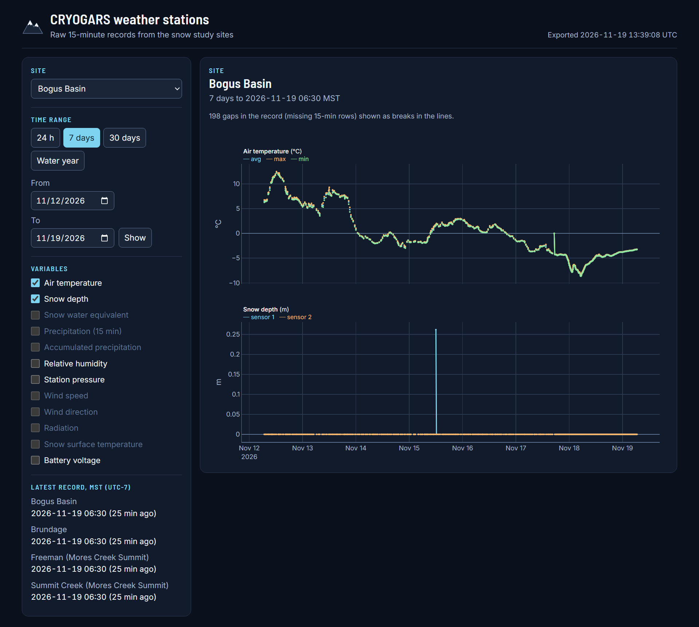

# CRYOGARS weather stations

Interactive viewer for the CRYOGARS Lab weather stations (Bogus Basin, Brundage, and Mores Creek
Summit: Freeman and Summit Creek). Pick a site, a time range, and variables to plot from the raw
15-minute records. Times are MST (UTC-7).

**Viewer:** https://tvanderweide.github.io/cryogars-wx/

The data are updated every 15 minutes and published to the `gh-pages` branch, which holds the
site and its CSV files. Data are raw and not quality controlled.
